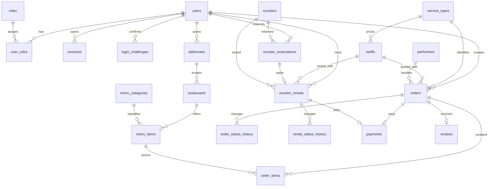

# Данные, связи и исторические факты

Основные сущности используют UUID; коды справочников `roles`, `service_types`, `order_statuses` — текстовые ключи. `user_roles` имеет составной ключ `(user_id, role_code)`. Потенциальные ключи: `users.email`, `scooters.code`, `scooters.qr_code`, `menu_items(restaurant_id,name)`, `sessions.token_hash`. Внешние ключи связывают заказ с клиентом, типом услуги, тарифом, адресами и назначенным исполнителем. `order_items` и `user_roles` хранят многозначные связи отдельными строками. Метаданные аудита не используются как источник основных бизнес-связей.

| Поле | Назначение |
| --- | --- |
| `orders.customer_id`, `service_type_code`, `tariff_id` | Владелец, услуга и применённая версия тарифа |
| `orders.pickup_snapshot`, `dropoff_snapshot` | Адресные строки на момент оформления |
| `orders.pickup_lat_snapshot`, `pickup_lng_snapshot`, `dropoff_lat_snapshot`, `dropoff_lng_snapshot` | Географические точки на момент оформления |
| `orders.restaurant_name_snapshot` | Название заведения при покупке |
| `orders.delivery_amount`, `discount_amount`, `total_amount` | Компоненты серверного расчёта в тенге |
| `order_items.item_name_snapshot`, `unit_price`, `quantity` | Купленное блюдо, цена и количество, независимо от действующего меню |
| `scooter_reservations.expires_at` | Серверный срок окончания брони |
| `scooter_rentals.started_at`, `ended_at` | UTC-моменты для итогового расчёта |
| `parking_zones.boundary` | Полигон PostGIS, WGS84 / SRID 4326 |

Основные функциональные зависимости: `user_id → email, full_name, password_hash`; `menu_item_id → restaurant_id, category_id, current_price`; `order_id → customer_id, service_type_code, tariff_id, status_code, total_amount`; `order_item_id → order_id, menu_item_id, purchased_quantity, purchased_unit_price`. Непосредственные факты о текущем каталоге живут в таблицах каталога, а состояния — в заказе и хронологии переходов. Повторяющихся групп и строковых списков ключей нет. Снимки сделки намеренно дублируют текущие адреса и позиции меню: это отдельные факты *на дату покупки*, поэтому изменение справочника не может пересчитать старый заказ. Использованный тариф защищён от UPDATE и DELETE; новые правила оформляются новой версией. Защитный триггер запрещает изменение исторических денежных и адресных полей заказа.

Статусы такси: `pending → assigned → accepted → arriving → in_progress → completed`. Статусы еды: `pending → preparing → assigned → accepted → picked_up → completed`. Отмена возможна только на ранних стадиях и проверяется сервером. Каждое изменение статуса и назначение проходят в транзакции с `FOR UPDATE`; история содержит исходный и новый статусы и инициатора. Частичные уникальные индексы исключают одновременные активные брони/аренды для самоката и клиента. Истечение брони проверяется сервером при операциях даже после его перезапуска. Завершение аренды разрешено только в активной зоне, включая её границу (`ST_Covers`). Координаты — градусы широты/долготы, расстояние автомобильного маршрута — метры, длительность — секунды, деньги — `NUMERIC(12,2)` и серверный `Decimal`.
